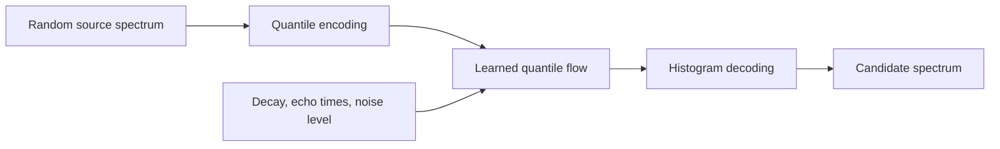

# QWFM for NMR Reconstruction

**Quantile–Wasserstein Flow Matching for NMR Relaxation Spectrum Reconstruction**

Conditional generation of NMR relaxation spectra from noisy decay measurements, using optimal transport in quantile space.

> Research implementation accompanying a manuscript currently under review.

[Overview](#overview) · [Method](#method) · [Installation](#installation) · [Usage](#usage) · [Code structure](#code-structure) · [Paper](#paper)

## Overview

Recovering a relaxation spectrum from an NMR decay signal is an ill-conditioned inverse Laplace problem: different spectra can explain similar measurements. **QWFM learns to generate a distribution of candidate spectra conditioned on the observed decay, echo times, and noise level.** Each reconstruction is a complete, nonnegative spectrum with unit total mass.

The central idea is to represent a spectrum by **quantile positions on the logarithmic relaxation-rate axis**. Linear interpolation of one-dimensional quantile functions describes a quadratic Wasserstein ($W_2$) geodesic: it transports spectral mass along the rate axis. QWFM uses a finite quantile representation of this path within conditional flow matching.

### Key ideas

- **Probabilistic reconstruction.** Generate multiple candidate spectra for the same measurement to study reconstruction ambiguity through approximate posterior sampling.
- **Transport-aware spectral representation.** Learn in quantile coordinates, where interpolation moves mass along the ordered log-rate axis. Histogram-linear flow matching (HFM), also included here, interpolates masses at fixed rate bins.
- **Direct training from simulated pairs.** Learn the quantile velocity with the standard flow-matching regression objective using spectrum–decay pairs. Posterior reference samples are used for evaluation, not as training targets.

The repository includes a synthetic NMR simulator, training and sampling code, reference-posterior construction, evaluation, and visualization. Supporting baselines include HFM, deterministic regression, conditional VAEs, conditional normalizing flows, and classical regularized inversion methods.

## Method

The simulator draws target spectra from a Gamma-mixture prior and generates noisy measurements through an exponential decay kernel. Training pairs are generated on the fly. The flow's random starting spectra are drawn independently from a Dirichlet distribution; this source distribution is distinct from the prior over target spectra.

1. **Encode spectra.** Convert source and target histograms into quantile vectors $\mathbf q_0$ and $\mathbf q_1$ on the normalized log-rate axis.
2. **Learn the flow.** A conditional 1D U-Net predicts the velocity along the interpolating path, given the decay measurements, echo times, noise level, and flow time.
3. **Generate candidates.** Integrate the learned velocity from a new source using explicit Euler steps. Clip positions to the supported interval and apply isotonic regression after each step to maintain nondecreasing quantiles.
4. **Decode spectra.** Convert the final quantiles into nonnegative, unit-mass histograms. Repeat with new sources to obtain multiple reconstructions for one observation.

The training path and objective are

$$
\mathbf q_t=(1-t)\mathbf q_0+t\mathbf q_1,
\qquad t\sim\mathcal U(0,1),
$$

$$
\mathcal L_{\mathrm{QWFM}}=
\mathbb E\!\left[\frac{1}{L}
\left\|v_\theta(\mathbf q_t,t,\mathbf c)-(\mathbf q_1-\mathbf q_0)\right\|_2^2\right],
$$

where $\mathbf c$ contains the measurement, acquisition, and noise information, and $L$ is the number of quantiles. Flow time $t$ is distinct from the physical echo times. The quantile count can be selected independently of the number of spectrum bins.



**Scope.** The supplied workflows use one-dimensional synthetic relaxation spectra with fixed acquisition schedules and Gaussian noise. They provide a research workflow for training and evaluation; importing experimental instrument files requires additional data preparation.

## Installation

Use **Linux/Bash** and a Python environment with a **CUDA-compatible PyTorch** installation. Install the [PyTorch build appropriate for your machine](https://pytorch.org/get-started/locally/) first, then install the repository dependencies:

```bash
git clone https://github.com/rechido/qwfm_nmr_reconstruction.git
cd qwfm_nmr_reconstruction
python -m pip install -r requirements.txt
```

Dependencies include PyTorch, Hugging Face Accelerate and Diffusers, NumPy, SciPy, and Matplotlib. Version constraints are listed in [requirements.txt](requirements.txt).

Training data are generated locally, so no dataset download is needed. Pretrained checkpoints are not included; train a model before running its sampling and evaluation scripts.

## Usage

The example below uses **64 measurements, 128 spectrum bins, and 128 quantiles** (`m64n128`, `L=128`). Run commands from the repository root.

**Before running:** the training and proper-score sample-generation scripts default to four GPUs (`GPU_IDS="0,1,2,3"`, `NUM_PROCESSES="4"`). Review these settings and the batch sizes in the scripts. The defaults are full research runs, including 200,000 training iterations.

<details>
<summary>Using a single GPU</summary>

- In the training script, set `GPU_IDS="0"` and `NUM_PROCESSES="1"`; its launcher already supports a single process. Reduce `--train_batch_size` if needed.
- In the proper-score sample-generation script, replace `accelerate launch` and its launcher options (through `--main_process_port 0`) with `CUDA_VISIBLE_DEVICES=0 python`. Keep the Python entry point and its arguments. This script uses `--multi_gpu` unconditionally, so changing the GPU variables alone is insufficient.

</details>

### 1. Train QWFM

```bash
bash scripts/m64n128/02_train_quantile_wasserstein_l128.sh
```

This generates training pairs and saves model checkpoints, configuration, and logs under `outputs/m64n128/`. The script resumes from the latest compatible checkpoint when one exists. Evaluation uses the saved exponential-moving-average model weights.

### 2. Generate samples and evaluate with simulated ground truth

Prepare a shared set of observation–spectrum pairs, generate conditional reconstruction samples, and compute the **energy score (ES)** and **Gaussian kernel score (KS)**:

```bash
bash scripts/m64n128/proper_scores/00_prepare_test_conditions.sh
bash scripts/m64n128/proper_scores/quantile_wasserstein_l128/01_generate_samples.sh
bash scripts/m64n128/proper_scores/quantile_wasserstein_l128/02_evaluate_scores.sh
```

The first command prepares evaluation data, the second loads the trained model, and the third computes scores on CPU and produces comparison tables and figures. This workflow does not require SMC reference samples.

<details>
<summary>Alternative evaluation: compare samples with SMC posterior references</summary>

Build three independent sequential Monte Carlo (SMC) reference runs, then audit their consistency. Run model evaluation only after the audit passes:

```bash
bash scripts/m64n128/00a_build_posterior_reference_run0.sh
bash scripts/m64n128/00b_build_posterior_reference_run1.sh
bash scripts/m64n128/00c_build_posterior_reference_run2.sh
bash scripts/m64n128/00d_audit_posterior_references.sh
bash scripts/m64n128/02_evaluate_quantile_wasserstein_l128.sh
```

This workflow compares generated and reference samples using spectral distances and precision, recall, density, and coverage (PRDC), together with forward-decay consistency diagnostics. The reference-building scripts use CUDA; the QWFM evaluation script defaults to one GPU.

To plot the saved SMC-based evaluation metrics and reconstructed spectra:

```bash
bash scripts/m64n128/90_plot_metrics_all_methods.sh
bash scripts/m64n128/94_visualize_all_methods.sh
```

These plotting scripts skip methods whose evaluation files are absent, so they can be used after evaluating QWFM alone.

</details>

### 3. Inspect outputs and select other configurations

All generated artifacts for this setting are stored under `outputs/m64n128/`:

| Location | Contents |
| --- | --- |
| `quantile_wasserstein_m64_n128_l128_unet64x4_t1024/` | Model checkpoints, configuration, training logs, and SMC-based model evaluations |
| `proper_scores/` | Shared synthetic test pairs and generated reconstruction samples |
| `metric_comparisons/` | Evaluation summaries, comparison tables, and metric plots |
| `qualitative/` | Reconstruction figures from the SMC-based visualization workflow |
| `reference_smc4096_v2/` | SMC reference samples and audit artifacts, when that workflow is run |

The launch scripts also provide QWFM variants with **256 or 512 quantiles** and a **32-measurement** setting. Complete command lists for the available models and workflows are in [32-measurement examples](run_examples_m32n128.txt) and [64-measurement examples](run_examples_m64n128.txt). Keep the simulator settings and output paths consistent across training and evaluation.

## Code structure

| Path | Purpose |
| --- | --- |
| [`codes/data/`](codes/data/) | Spectrum and decay simulation, grids, and SMC references |
| [`codes/train/`](codes/train/) | Training entry points |
| [`codes/trainers/`](codes/trainers/) | Model-specific training objectives |
| [`codes/samplers/`](codes/samplers/) | Reconstruction and sampling implementations |
| [`codes/evaluate/`](codes/evaluate/) | Sample generation, reference audits, evaluation, and plotting |
| [`codes/metrics/`](codes/metrics/) | Spectral distances, distributional scores, and physics diagnostics |
| [`codes/utils/`](codes/utils/) | Representations, conditioning, model configuration, and checkpoints |
| [`scripts/`](scripts/) | Configured launch scripts for the supported workflows |

For the core QWFM implementation, start with the [training objective](codes/trainers/quantile_wasserstein_trainer.py), [sampler](codes/samplers/quantile_wasserstein_sampler.py), and [histogram–quantile utilities](codes/utils/nmr_utils.py).

## Paper

**Quantile–Wasserstein Flow Matching for NMR Relaxation Spectrum Reconstruction**

Da Eun Lee and Byung-Woo Hong · Department of AI, Chung-Ang University

*Manuscript under review.*

## Questions and contributions

Please use [GitHub Issues](https://github.com/rechido/qwfm_nmr_reconstruction/issues) for questions and bug reports. Include the command you ran, your environment, and the relevant error output. Proposed improvements can be submitted as pull requests.

## License

A license has not yet been specified for this repository.
